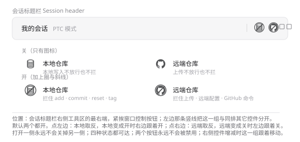

# Git 仓库保护 · dsh-git-guard

会话标题栏右侧的一对开关，拦住 agent 写入本地 git 仓库或把它上传到远端。

| 开关 | 位置 | 拦住什么 |
| --- | --- | --- |
| 本地仓库 | 左 | 写入本地仓库的操作：`git add`、`git commit`、`git reset`、`git merge`、`git tag` 等 |
| 远端仓库 | 右 | 触达远端的操作：`git push`、`git pull`、`git clone`、`git remote`、`gh` 等 |

两个都默认开启。拦截发生在命令真正执行**之前**，被拒绝的操作不会执行，agent 会收到明确的拒绝理由。



## 安装

```bash
dsh plugin --profile <profile> add @yokira404/dsh-git-guard
```

装好后重新加载页面，即可在会话标题栏右侧看到这两个开关。

> 手动登记 profile 也可以：在 `~/.dsh/profiles/<profile>/package.json` 的 `dsh.profile.bundles` 里加上 `@yokira404/dsh-git-guard`，并在 `dependencies` 里写 `"^1.0.1"`。

## 开关怎么联动

两者的关系只有两条，都是**一次点击的后果**，没有「必须一直成立」的约束：

| 点击 | 本地 | 远端 |
| --- | --- | --- |
| 左（本地） | 取反 | 本地变成**开**时，远端跟着**开**；本地变成关时，远端不动 |
| 右（远端） | 远端变成**关**时，本地跟着**关**；远端变成开时，本地不动 | 取反 |

- **打开一侧永远不会关掉另一侧**：打开一个保护，不该顺手拆掉另一个保护。
- **关闭远端会连带关闭本地**：本地写入正是上传要带走的东西，只放开远端等于留着一半。
- 特例：**两个都关时点右侧**，只打开远端、本地保持关闭。这是有意留的口子 —— 只拦上传、不拦本地写入。

四种状态都可达：

| 状态 | 本地写入 | 上传远端 |
| --- | --- | --- |
| 开 · 开（默认） | 拦 | 拦 |
| 关 · 开 | 放行 | 拦 |
| 开 · 关 | 拦 | 放行 |
| 关 · 关 | 放行 | 放行 |

## 判定范围

**会被拦 · 左开关** —— 写入本地仓库：

```
git add · git commit · git am · git apply · git checkout-index · git config
git merge · git mv · git notes · git rebase · git reset · git restore
git revert · git rm · git stash · git switch · git tag
git update-index · git update-ref
```

**会被拦 · 右开关** —— 触达远端：

```
git push · git pull · git fetch · git clone · git ls-remote · git remote
git submodule · git send-pack · git archive · git request-pull · git svn
gh repo / pr / release / issue / run / workflow / api / gist / secret / …
命令行上直接出现 github.com、gitlab.com、gitee.com 等仓库地址
```

**不会被拦**：`git status`、`git log`、`git diff`、`git show`、`git branch`、`git blame`、`git init`、`git rev-parse`、`git check-ignore`、`git ls-files`、`git worktree`、`git help`、`gh auth`、`gh config`、`gh api /user`，以及任何与 git 无关的命令。`git init` 是有意放行的：建仓库既不上传也不提交。

判定是**引用感知**的：`git commit -m "do not push this"` 是本地提交，不是上传；`echo "git push" > notes.txt` 什么都不是。判定也不吃前缀：`sudo git push`、`env FOO=1 git commit`、`C:\Program Files\Git\cmd\git.exe push` 都能识别出来。

## 被拦时 agent 看到什么

```
已阻止：DSH 的「Git 仓库保护」插件当前开着左侧的本地仓库开关，
写入本地仓库的操作（git add / git commit 等）被拒绝。
被拦截的命令：`git commit -m x`
这是用户有意设置的开关，不是故障：不要改用其他命令、其他工具或直接调用 API 绕过它，
也不要尝试关闭该开关。请把这一步作为「未执行」如实报告给用户，
并说明用户可以点击会话标题栏的两个方形按钮自行放行。
```

## 已知限制

- **不改动你的仓库**：不写 `.git/hooks`，不碰 `git config`，只做拦截。
- **会误伤「正文里写着命令名」的调用**：判定看的是工具调用里命令类字段（`command` / `script` / `code` 等）的整串文本，所以用 `write` 写一份含 `git push` 字样的文档时，那次写入本身可能被拦。这是有意的偏向 —— 宁可多拦一次写入，也不放过一次上传；换个写法即可正常写入。
- **拦不住不走 shell 的路径**：它针对的是 agent 通过命令上传仓库这条真实路径。
- **不做事后撤销**：拦在事前，不存在已经推上去再回滚的窗口。
- **状态不持久化**：DSH 重启后回到「两个都开启」。

## 许可

MIT
